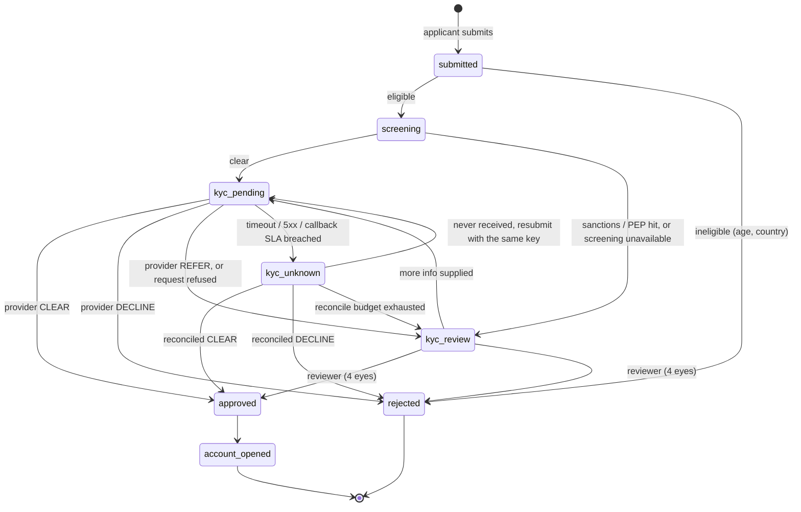

# Neobank onboarding — a KYC process built as a state machine

A reference implementation, not a client system: the actual artifacts, so you
can disagree with the decisions.

> **Status.** The database layer and the workflow logic are tested — 29 tests
> run the workflow's own SQL and JavaScript against real Postgres 16 (PGlite)
> with a stubbed screening service and KYC provider (`npm test`). It has **not**
> been run inside a live n8n instance or against a real KYC or screening
> provider. Treat it as a design you can execute, not a product.

| File | What it is |
|---|---|
| `onboarding.bpmn` | BPMN 2.0 — opens in [bpmn.io](https://demo.bpmn.io) or Camunda Modeler |
| `schema.sql` | Postgres: states, allowed transitions, the functions the orchestrator may call, audit, review queue |
| `workflow.n8n.json` | n8n workflow — importable; 40 nodes, 3 entry points (submit, provider callback, reconciler) |
| `openapi.yaml` | The API contract, including what each 409 means |
| `postman_collection.json` | 7 requests — 4 of them are the failure cases |
| `tests/` | `schema.test.mjs` (the rules in the database) · `workflow.test.mjs` (the workflow, executed node by node) · `harness.mjs` |

---

## The state machine



(`draft` and `expired` exist in the schema for the applicant-facing side and
for ageing out; this workflow starts at `submitted`.)

**Transitions are data, not code.** `app.application_transition_allowed` holds
`(from_state, to_state, actor)`. Adding a state is a migration, not a redeploy of
every workflow that touches onboarding — and an illegal transition is refused by
the database, not by a convention someone has to remember.

---

## Six decisions worth arguing about

**1. A timeout is `kyc_unknown`, never `rejected`.**
Declining a customer because our network hiccuped is a compliance incident, not
a bug. `kyc_unknown` is a first-class state with its own reconciliation loop,
and nothing downstream fires while an application is indeterminate. The same
applies when the provider simply never calls back: past a 6-hour SLA the
application becomes `kyc_unknown` and the reconciler asks the provider directly
(the BPMN boundary timer, implemented as `app.flag_overdue_pending`).

**2. Query first, resubmit second — and only when certain.**
The reconciler `GET`s the provider by our own `client_reference` before it
considers resubmitting. Blind resubmission is how one applicant becomes two
identities, and how you pay a KYC vendor twice for the same check. A resubmit
reuses the *same* `Idempotency-Key` as the original submit.

**3. The orchestrator never writes state — and can't.**
The workflow's database role (`service_role`) has no table privileges at all,
only `EXECUTE` on six functions. `app.transition_application()` locks the row,
checks the transition table, then writes state **and** the audit row in one
transaction, and is idempotent on a transition key. It returns
`applied | duplicate | forbidden | not_found` rather than raising — an exception
would roll back the caller's own bookkeeping.

**4. Intent is recorded before the side effect.**
`screening → kyc_pending` is written *before* the KYC provider is called. If
the process dies mid-call, the application is findable; a request we never
recorded making is the one nobody ever retries.

**5. `approved` has no way back.**
The only transition out of `approved` is `account_opened`. KYC approval is a
durable, audited fact; undoing it is a new case with its own record, not a
silent `UPDATE`. This is also what makes late and replayed provider callbacks
harmless — a decided application has no transition they could take, so the
database answers `forbidden` and the callback is simply acknowledged. When core
banking is unavailable *after* approval, the compensation is retry and an ops
queue — **not** un-approving the customer (the non-interrupting boundary event
on `Task_OpenAccount`).

**6. Human review is a control, not a fallback.**
A sanctions hit, unavailable screening, a provider `REFER` and an exhausted
reconciliation all land in `app.review_task`. The task is opened **by the
transition function** whenever an application enters `kyc_review`, so no
workflow branch can forget it, and there is at most one open task per
application. Maker–checker is a `check (checker_id <> maker_id)` constraint.

---

## Webhook hardening (`Verify HMAC (raw body)`)

Four separate concerns, all mandatory, in this order:

1. **Verify over the raw bytes, before parsing.** The callback webhook runs with
   `rawBody: true`, which keeps the exact bytes as binary `data` — `json.body` is
   already a parse. Re-serialising a parse changes bytes and the signature will
   never match, and "fixing" that by trusting the parse means no signature check
   at all. (`tests/workflow.test.mjs` signs a body with spaces in it to prove the
   raw bytes are what's verified.)
2. **Constant-time compare** (`crypto.timingSafeEqual`, with a length check first,
   because it throws on mismatched lengths).
3. **Timestamp tolerance** (±300 s) so a captured payload cannot replay forever.
4. **Only then** read the contents.

Delivery is at-least-once and unordered, so on top of the signature:
`app.record_provider_event` inserts on the provider's `event_id` with
`ON CONFLICT DO NOTHING` and reports whether the event is new, and the
transition is keyed on that `event_id`, so the same event can never move the
state twice. `sequence_no` is recorded for audit; ordering safety comes from
the transition table (decision 5), not from comparing sequence numbers.

---

## Idempotency, precisely

The submit key is derived from the **business event** — `customer + product` —
never from the attempt. If the client omits `Idempotency-Key`, the workflow
derives `sha256(customer_external_ref:product_code)`, so a client that forgets
the header still cannot create duplicates.

Same key with a **different** payload returns **409**. Silently returning the
original would hide a client bug, or an attempt to swap the applicant behind a
key that is already known. The fingerprint is a SHA-256 of the request with keys
sorted at every depth — sorting only the top level, or using
`JSON.stringify`'s replacer array (which also filters nested keys), would
fingerprint every applicant as `{}` and the 409 would never fire.

`app.submit_application` does find-or-create in one statement
(`ON CONFLICT (idempotency_key) DO UPDATE … RETURNING (xmax = 0)`), so two
concurrent submits produce one application and both callers get it back. It
returns one of:

| outcome | HTTP | meaning |
|---|---|---|
| `created` | 201 | new application; response carries the state it reached |
| `replay` | 200 | same key, same payload — current state returned, process **not** restarted |
| `key_conflict` | 409 | same key, different payload |
| `already_open` | 409 | a live application already exists for this customer + product under another key |

A rejected applicant who reapplies is a new business event: the client must send
a new `Idempotency-Key` (the derived key would replay the rejected application).

Malformed input is a **400** and creates nothing. Business ineligibility (under
18, unsupported country) creates the application and rejects it with a reason —
a decline is an audited state, not a lost HTTP error.

---

## Tests

```bash
npm install
npm test      # 29 tests, ~40 s — no database server or n8n needed
```

- `schema.test.mjs` — the orchestrator role cannot read or write any table;
  submit outcomes; illegal transitions refused; approval irreversible; one open
  review task; four-eyes constraint; `kyc_unknown` scheduled, claimed when due,
  backed off; provider-event dedupe.
- `workflow.test.mjs` — loads `workflow.n8n.json` and executes it node by node:
  happy path to `approved`; replay; 409 on a swapped applicant; derived key;
  `already_open`; 400; ineligible; sanctions hit (KYC never called); screening
  down; provider timeout; replayed and late callbacks; tampered / stale /
  wrong-secret / missing-secret signatures; raw-bytes verification; the
  reconciler handling found, still-running and never-received applications in
  one pass with the same idempotency key; exhausted budget; callback SLA.

`harness.mjs` is a small interpreter for exactly the node types this workflow
uses (Code, IF, Postgres, HTTP Request, Respond to Webhook). It runs the
workflow's own SQL and JavaScript, so a red test means the shipped workflow is
wrong — but it is not n8n, and it does not prove n8n-specific behaviour such as
retries, credentials or execution settings.

---

## Running it in n8n

```bash
psql "$DATABASE_URL" -f schema.sql
psql "$DATABASE_URL" -c "create role onboarding_app login password '…'; grant service_role to onboarding_app;"
```

Then in n8n: **Import from file → `workflow.n8n.json`**, and

- create a Postgres credential that logs in as `onboarding_app`, and an HTTP
  Header Auth credential for the KYC provider; assign both where the nodes say
  `REPLACE_ME`;
- set `KYC_PROVIDER_URL`, `SCREENING_URL`, `KYC_WEBHOOK_SECRET`, `PUBLIC_BASE_URL`;
- allow the Code nodes what they use: `NODE_FUNCTION_ALLOW_BUILTIN=crypto`, and
  `$env` access (`N8N_BLOCK_ENV_ACCESS_IN_NODE=false`) — or move the secret into
  a credential if your instance blocks environment access.

Postman: import the collection, set `baseUrl` and `webhookSecret`, run in order.
Requests 3, 6 and 7 are the ones to run first: a green happy path proves very
little; a 409 on key reuse and a 401 on a tampered body prove the controls exist.

---

## What this deliberately does not do

- **No ledger.** Onboarding does not move money, so there is nothing to
  double-entry here. A payment flow would need one, and a status column would
  not be a substitute.
- **PII still crosses the orchestrator.** The applicant is sent to the screening
  service from the workflow, and n8n retains execution payloads — for a bank,
  pass applicant data by reference and shorten execution retention.
- **No account opening or review UI.** The BPMN models them; the workflow stops
  at the decision.
- **Not tuned for scale.** The reconciler claims 25 rows per pass with
  `FOR UPDATE SKIP LOCKED`; the shape is right, the numbers are illustrative.
